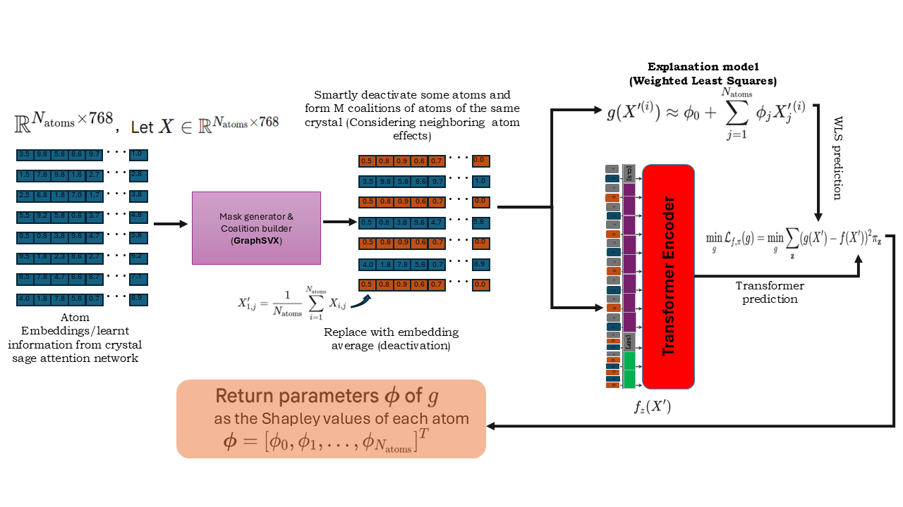
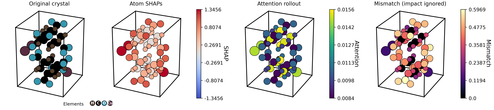
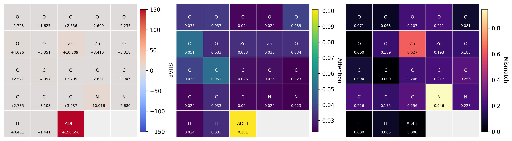

# ExCTransformer

**Current stable release: [v1.0.1](https://github.com/kkasiedu1914/ExCTransformer/releases/tag/v1.0.1)** — includes the installed `exct-download` argument fix. [Software DOI](https://doi.org/10.5281/zenodo.23648584).

ExCTransformer is an explainable crystal-graph transformer package for adsorption-property modeling in porous crystalline materials, especially metal-organic frameworks (MOFs). It supports crystal graph construction from CIF files, model training and inference, GraphSVX-style atom attribution, and visualization of saved explanation outputs.

The package is distributed as `exctransformer` and provides both Python APIs and Linux/HPC-friendly command-line entry points.



The workflow converts crystal structures into graph representations, encodes local atom neighborhoods with graph message passing, applies transformer layers for global context, and estimates atom-level Shapley values with GraphSVX-style perturbations. Saved explanations can be visualized or compared against attention-based rankings through faithfulness analysis.

## Capabilities

- Build HDF5 graph datasets from CIF folders or CIF archives
- Train ExCTransformer models for regression, binary classification, or multiclass classification
- Evaluate checkpoints and export prediction CSV files
- Generate single-sample or batch SHAP explanations
- Visualize saved explanation payloads
- Download versioned datasets, checkpoints, metadata, and explanation bundles from the official Figshare asset record

## Installation

Use **Python 3.11** on Linux. These instructions install CPU PyTorch.
For GPU use, install a matching PyTorch/CUDA build instead of the CPU wheel.
Start in a virtual environment:

```bash
git clone --branch v1.0.1 --depth 1 https://github.com/kkasiedu1914/ExCTransformer.git
cd ExCTransformer
python3.11 -m venv .venv
source .venv/bin/activate
python -m pip install --upgrade pip
python -m pip install torch==2.4.1 torchvision==0.19.1 --index-url https://download.pytorch.org/whl/cpu
python -m pip install -c requirements/constraints-py311.txt .
exct --help
```

This is a regular, non-editable installation. The distribution name is
`exctransformer`; this release is installed from GitHub or a source checkout,
not from a claimed PyPI publication. The repository and stable release are public;
cloning and downloading release artifacts require no account or API token.

For development, use `python -m pip install -c requirements/constraints-py311.txt -e ".[dev]"`.
The constraints record the runtime versions used in release validation.

## Start here: CPU tutorial

```bash
python examples/cpu_quickstart.py --output example-output
```

This generates twelve tiny synthetic crystals, builds graph files, trains a small
ExCT for one epoch, saves a checkpoint, and writes prediction CSVs. It needs no
external dataset or pretrained weights. Use a fresh output directory for each run.
The targets are artificial: this checks the workflow, not adsorption accuracy.
Add `--explain` to compute and render a GraphSVX explanation as well.
See [the tutorial](docs/quickstart.md) for inputs, outputs, and next steps.

## Documentation

- [CPU quickstart and custom datasets](docs/quickstart.md)
- [Research datasets and checkpoints](docs/assets.md)
- [Explanation visualization](docs/visualization.md)
- [Faithfulness comparison](docs/faithfulness.md)
- [Contributing](CONTRIBUTING.md)
- [Release validation and scope](docs/release-validation.md)

## Command Line

The main CLI is `exct`:

```bash
exct --help
exct train --help
exct test --help
exct predict --help
exct explain --help
exct build-dataset --help
exct download --help
```

Shortcut entry points are also installed:

```bash
exct-train --help
exct-test --help
exct-predict --help
exct-explain --help
exct-build-dataset --help
exct-download --help
```

## Official Assets

**Research asset access:** the Figshare dataset is public as of 2026-10-25. The download commands below work without an account or API token. The CPU quickstart and use with your own data also remain self-contained.

Full datasets, pretrained checkpoints, and generated outputs are hosted outside the source repository. The published Figshare asset record is:

- Figshare article: `https://doi.org/10.6084/m9.figshare.31941117.v1`
- Citation: `Asiedu, Kwabena Koranteng; Achenie, Luke E. K.; Asiedu, Nana Yaw (2026). ExCTransformer. figshare. Dataset. https://doi.org/10.6084/m9.figshare.31941117.v1`
- Asset license: CC BY 4.0

The source repository contains only code, documentation, tests, manifests, and tiny fixtures. Large graph datasets, CIF collections, checkpoints, saved explanation bundles, logs, and generated media are not stored in git.

Downloaded files are cached under:

```bash
~/.cache/exctransformer/assets/
```

Set a different cache directory with:

```bash
export EXCTRANSFORMER_ASSETS_DIR=/path/to/exctransformer-assets
```

List available assets:

```bash
exct download list
exct-download list
```

Download individual assets:

```bash
exct download fetch exctransformer-base
exct download fetch exctransformer-pm
exct download fetch hmof-graph-data
exct download fetch experimental-cifs
exct download fetch hmof-metadata
exct download fetch hmof-metadata-v2
exct download fetch id-prop-reg-h2
exct download fetch atom-init
exct download fetch synthesized-structure-explanations
```

Download into a project-local directory:

```bash
exct download fetch exctransformer-base --destination ./release-assets
```

Download all official release assets:

```bash
exct download all --destination ./release-assets
```

Download only one asset category:

```bash
exct download all --kind model --destination ./release-assets
exct download all --kind data --destination ./release-assets
exct download all --kind metadata --destination ./release-assets
exct download all --kind explanation --destination ./release-assets
```

The downloader verifies the checksum recorded in `assets/manifests/v1.0.1.json`. Figshare currently exposes MD5 checksums for these files, and the package verifies those MD5 values. Local or future mirrors can also use SHA256 entries in the same manifest format.

`hmof-graph-data` and `synthesized-structure-explanations` are archive assets and are extracted automatically by default. `experimental-cifs` is a RAR archive; the package downloads and verifies it but does not auto-extract RAR files.

While the Figshare article is private, authenticated maintainers can validate the same manifest URLs by setting:

```bash
export FIGSHARE_TOKEN_FILE=/path/to/figshare_token.txt
```

or:

```bash
export FIGSHARE_TOKEN=...
```

Once the Figshare article is public, the same direct file URLs are expected to work without either environment variable.

## Python Use Cases

Build an HDF5 graph dataset from a CIF folder:

```python
from exctransformer.datamodule.workflows import build_h5_dataset_workflow

build_h5_dataset_workflow(
    data_dir="/path/to/data_root",
    cif_id_prop="id_prop_reg_h2",
    cif_path_z="/path/to/cif_folder",
    output_h5="/path/to/output_graph_data",
    dataset_size=1000,
)
```

Build the same dataset from a CIF ZIP archive:

```python
from exctransformer.datamodule.workflows import build_h5_dataset_workflow

build_h5_dataset_workflow(
    data_dir="/path/to/data_root",
    cif_id_prop="id_prop_reg_h2",
    cif_path_z="/path/to/case_bundle.zip",
    output_h5="/path/to/output_graph_data",
    zip=True,
)
```

Train a model:

```python
from exctransformer.train import train

train(
    dataset_path="/path/to/graph_data",
    log_dir="logs/",
    num_targets=3,
    max_epochs=50,
    batch_size=64,
)
```

Evaluate a checkpoint:

```python
from exctransformer.test import test

test(
    dataset_path="/path/to/graph_data",
    model_path="/path/to/best.ckpt",
    num_targets=3,
)
```

Run prediction:

```python
from exctransformer.predict import predict

predict(
    dataset_path="/path/to/graph_data",
    model_path="/path/to/best.ckpt",
    num_targets=3,
)
```

Explain one structure:

```python
from exctransformer.explain import explain

result = explain(
    data_dir="/path/to/graph_data",
    model_path="/path/to/best.ckpt",
    pred_idx=0,
    single_id="hMOF-1015",
    cif_dir="/path/to/cif_folder",
    out_dir="shap_outputs_single",
    model_kwargs={"num_targets": 3},
)

print(result.shap_output_path)
```

Visualize a saved explanation payload:

```python
from exctransformer.explain import visualize_explanation

visualize_explanation(
    shap_path="/path/to/sample_pred0_shap.pt",
    dataset_path="/path/to/graph_data",
    model_path="/path/to/best.ckpt",
    save_dir="figures",
    vis_modes=["dual", "attn-shap-3d"],
)
```

Compare SHAP and attention faithfulness:

```python
from exctransformer.explain import compare_faithfulness

compare_faithfulness(
    h5_path="/path/to/sample.h5",
    shap_output_path="/path/to/sample_pred0_shap.pt",
    model_path="/path/to/best.ckpt",
    dataset_path="/path/to/graph_data",
    zip_path="/path/to/case_bundle.zip",
    pred_idx=0,
)
```

## CLI Use Cases

Build graph data:

```bash
exct build-dataset /path/to/data_root id_prop_reg_h2 /path/to/cif_folder /path/to/output_graph_data
```

Build graph data from a CIF ZIP archive:

```bash
exct build-dataset /path/to/data_root id_prop_reg_h2 /path/to/case_bundle.zip /path/to/output_graph_data --zip
```

Train:

```bash
exct train /path/to/graph_data --set num_targets=3 --set max_epochs=50 --set batch_size=64
```

Test:

```bash
exct test /path/to/graph_data /path/to/best.ckpt --set num_targets=3
```

Predict:

```bash
exct predict /path/to/graph_data /path/to/best.ckpt --set num_targets=3
```

Explain one structure:

```bash
exct explain single /path/to/graph_data /path/to/best.ckpt 0 \
  --single-id hMOF-1015 \
  --cif-dir /path/to/cif_folder \
  --set num_targets=3
```

Explain one structure when CIFs are archived:

```bash
exct explain single /path/to/graph_data /path/to/best.ckpt 0 \
  --single-id hMOF-1015 \
  --zip-path /path/to/case_bundle.zip \
  --set num_targets=3
```

Visualize a saved explanation:

```bash
exct explain visualize /path/to/sample_pred0_shap.pt \
  --dataset-path /path/to/graph_data \
  --model-path /path/to/best.ckpt \
  --save-dir figures \
  --vis-modes dual attn-shap-3d
```

Compare faithfulness:

```bash
exct explain faithfulness /path/to/sample.h5 /path/to/sample_pred0_shap.pt \
  /path/to/best.ckpt /path/to/graph_data /path/to/case_bundle.zip
```

Faithfulness workflow details are in `docs/faithfulness.md`.

## Visualization Tutorial

The repository includes a compact visualization-only payload from the paper discussion set. It is small enough to ship with the source tree and does not require downloading the full graph dataset:

```text
assets/tutorial_data/visualization/hmof_20208/hMOF-20208.cif
assets/tutorial_data/visualization/hmof_20208/hMOF-20208_pred0_shap.pt
```
Render a 3D attention/SHAP comparison:

```bash
exct download fetch exctransformer-base --destination ./release-assets
exct download fetch synthesized-structure-explanations --destination ./release-assets

exct explain visualize \
  './release-assets/1.0.1/explanations/synthesized-structures/extracted/explanations/by_structure/2020[Cu][pts]3[ASR]1/ch4/2020[Cu][pts]3[ASR]1_pred2_shap.pt' \
  --model-path ./release-assets/1.0.1/models/exctransformer-base/exctransformer.ckpt \
  --save-dir docs/assets/visualization/generated \
  --filename-prefix 2020_cu_pts_ch4_pred2 \
  --vis-modes attn-shap-3d \
  --dpi 180
```

Output:




Attention comparison views require attention weights. If the saved payload does not already include them, pass a compatible checkpoint:

```bash
exct download fetch exctransformer-base --destination ./release-assets
```

Render a 2D attention/SHAP heatmap:

```bash
exct explain visualize assets/tutorial_data/visualization/hmof_20208/hMOF-20208_pred0_shap.pt \
  --model-path ./release-assets/1.0.1/models/exctransformer-base/exctransformer.ckpt \
  --save-dir docs/assets/visualization/generated \
  --filename-prefix hmof_20208_pred0 \
  --vis-modes attn-shap-2d \
  --dpi 180
```

Output:




More details are in `docs/visualization.md`.

## Configuration Overrides

CLI users can override package configuration values with repeated `--set KEY=VALUE` arguments. Values are parsed as Python literals when possible.

```bash
exct train /path/to/graph_data --set max_epochs=50
exct train /path/to/graph_data --set max_epochs=50 --set batch_size=64 --set learning_rate=1e-4
exct train /path/to/graph_data --set hidden_dims=128 --set graph_attn_heads=6 --set out_dim=768
exct predict /path/to/graph_data /path/to/best.ckpt --set num_targets=3
```

Structured values can be passed as quoted literals:

```bash
exct train /path/to/graph_data --set loss_names='{"regression": 1}'
```

Binary classification:

```bash
exct train /path/to/graph_data_bin \
  --set loss_names='{"regression": 0, "classification": 1}' \
  --set num_classes=2 \
  --set max_epochs=20

exct predict /path/to/graph_data_bin /path/to/best.ckpt \
  --set loss_names='{"regression": 0, "classification": 1}' \
  --set num_classes=2
```

Multiclass classification:

```bash
exct train /path/to/graph_data_mc \
  --set loss_names='{"regression": 0, "classification": 1}' \
  --set num_classes=3 \
  --set max_epochs=20

exct predict /path/to/graph_data_mc /path/to/best.ckpt \
  --set loss_names='{"regression": 0, "classification": 1}' \
  --set num_classes=3
```

For binary classification, target columns should contain `0/1` labels. For multiclass classification, target columns should contain integer class IDs such as `0`, `1`, and `2`.

## Data Conventions

`atom_init.json` is bundled in the package because it is core graph-construction metadata. Full metadata CSV files and graph datasets are available through `exct download`.

For CIF-based workflows:

- Use `--cif-dir` or a folder path when CIF files are available on disk.
- Use `--zip-path` or `--zip` only when the matching CIF source is archived.
- Keep large generated HDF5 graph data outside the git repository.
- Keep checkpoints, TensorBoard logs, prediction dumps, SHAP payloads, images, and animations outside the git repository.

## Tests

Run the lightweight test set:

```bash
python3 -m pytest tests/unit/test_assets.py tests/smoke/test_cli_download.py
```

Run all helper checks with `python -m pytest tests -q`. These cover manifests,
checksums, archive extraction, and the download CLI. GitHub Actions also builds
and installs a wheel and runs the CPU tutorial with explanations.

## Citation

For this software release, cite:

```text
Asiedu, K., & Achenie, L. (2026). ExCTransformer (v1.0.1) [Computer software]. Zenodo. https://doi.org/10.5281/zenodo.23648584
```

`CITATION.cff` supplies this version-specific software citation to GitHub. For a reference to the project across versions, use the [concept DOI](https://doi.org/10.5281/zenodo.20777272). Cite the specific release used for reproducible results.

The associated manuscript, “Property-Defining Feature Extraction in Porous Crystalline Materials Using Attention-Guided Cooperative Game Theory,” has been accepted by the *Journal of Chemical Information and Modeling*. Its paper DOI will be added when assigned; the software DOI above is already available independently.

When using the hosted datasets, checkpoints, or explanation assets, cite the Figshare asset record:

```text
Asiedu, Kwabena Koranteng; Achenie, Luke E. K.; Asiedu, Nana Yaw (2026). ExCTransformer. figshare. Dataset. https://doi.org/10.6084/m9.figshare.31941117.v1
```

## Contributions

See [CONTRIBUTING.md](CONTRIBUTING.md) for issue reports, development setup, and pull requests. 

## License

Original ExCTransformer code is licensed under the [MIT License](LICENSE).
Adapted components retain their upstream notices and licenses; see
[THIRD_PARTY_NOTICES.md](THIRD_PARTY_NOTICES.md).

The Figshare-hosted release assets are licensed as CC BY 4.0 according to the v1.0.0 Figshare article metadata.
